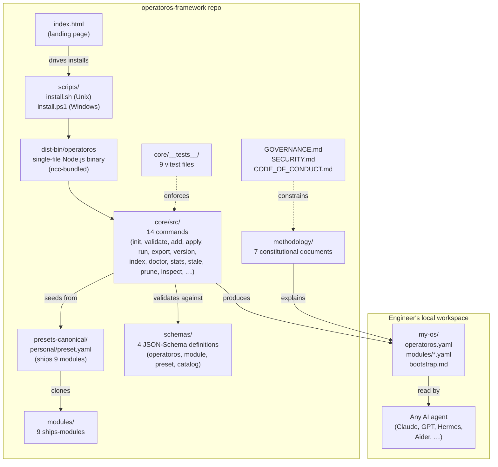

<div align="center">

# OperatorOS

**A methodology for engineers to build their own personal operating system — captured in documents, a typed scaffold, and a CLI that any AI agent can read.**

[](https://github.com/taras-polishchuk/operatoros-framework/releases/tag/v0.8.2)
[](./LICENSE)
[](https://nodejs.org)
[](https://github.com/taras-polishchuk/operatoros-framework/actions)
[](https://taras-polishchuk.github.io/operatoros-framework/)

</div>

> **Status:** v0.8.2 (Cross-platform install reliability, 2026-07-17) · **License:** MIT · **One-liner:** Seed, not install. You grow this into your own OS.

---

## The problem

Most engineers keep their working knowledge in four places that don't talk to each other: notes, terminal history, git config, and the agent context they re-paste every session. The system survives in your head, not on disk. When you bring a new AI agent into the workspace, you re-explain everything.

**OperatorOS** is a methodology-as-artifact that turns that personal system into a typed, version-controlled, inspectable scaffold — and produces a `bootstrap.md` so any AI agent (Claude, GPT, Hermes, Aider, …) can cold-start correctly.

It is **not** a productivity app, **not** a SaaS, **not** an AI-native runtime, **not** a multi-agent framework. See [What this is NOT](#what-this-is-not) for the explicit anti-positioning.

---

## Install

Requires **Node.js ≥ 20**. One command, no admin rights, installs to `~/.local/bin/operatoros`:

```bash
# Unix / Linux / macOS / WSL
curl -fsSL https://raw.githubusercontent.com/taras-polishchuk/operatoros-framework/main/scripts/install.sh | bash

# Windows (PowerShell)
iwr -useb https://raw.githubusercontent.com/taras-polishchuk/operatoros-framework/main/scripts/install.ps1 | iex

# Pin to a specific version (default: v0.8.2)
OPERATOROS_VERSION=v0.8.2 curl -fsSL https://raw.githubusercontent.com/taras-polishchuk/operatoros-framework/main/scripts/install.sh | bash
```

> **Important:** use `| bash`, not `| sh`. On Debian/Ubuntu/Alpine, `/bin/sh` is dash and the installer prints a helpful error if you use `sh`.

Verify with:

```bash
operatoros --version    # → operatoros-core: 0.8.0  (binary asset lags package.json — see CHANGELOG v0.8.1)
```

If `operatoros` is not found, add `~/.local/bin` to `PATH`:

```bash
echo 'export PATH="$HOME/.local/bin:$PATH"' >> ~/.bashrc && source ~/.bashrc
```

---

## Quick start (5 minutes)

After install, on any platform:

```bash
# 1. Scaffold a workspace
operatoros init --target my-os

# 2. Step into it
cd my-os

# 3. See your workspace through an AI's eyes
operatoros inspect --format terminal

# 4. Validate + check workspace health
operatoros validate operatoros.yaml && operatoros doctor

# 5. Apply the default preset (installs 9 ships-modules)
operatoros apply
```

That's the canonical onboarding path. The 9 modules that ship with v0.8.x extend further (see [CONTRIBUTING.md](./CONTRIBUTING.md) for the contract).

---

## Features

- **Typed Substrate** — every config file is validated against JSON-Schema before it's accepted. Invalid states cannot exist.
- **Local-First invariant** — `core/__tests__/local-first.test.ts` enforces no-network-call on the CLI. The constitutional principle is a test.
- **14 CLI commands** — `init`, `validate`, `add`, `apply`, `run`, `export`, `version` + the v0.7.0 Catalog (`index`, `doctor`, `stats`, `stale`, `prune`) + v0.8.0 `inspect`. Single-file bundle, no runtime dependencies beyond Node 20+.
- **Six lifecycle hooks** — observable events at init / add / validate / apply / run / export.
- **AI-usable without AI-dependent** — produces a `bootstrap.md` (~12K tokens) any agent can read. None required.
- **`inspect` works on any directory** — drop the binary into any project, see what an AI sees in 1 second. No setup, no install, no commit required.
- **9 ships-modules** — bootstrap-md, identity-md, context-builder, workspace-census, architecture-index, module-cookbook, drift-detector, mission-runner, bootstrap-tier-refresh.
- **Cross-platform** — Unix + Windows installers, single binary, no native deps.
- **Methodology-driven** — seven constitutional documents in `methodology/` (single-authority, replaceable, typed, composable, evidence-based, local-first, capability-selection).
- **9 test files** — vitest suite covering schema validation, command surface, local-first invariant, release gate, hooks, inspect, catalog.
- **Landing page** — [taras-polishchuk.github.io/operatoros-framework](https://taras-polishchuk.github.io/operatoros-framework/).

---

## Architecture



Three artifacts ship: **methodology** (documents), **scaffold** (preset + 9 modules), **CLI** (binary). Together they produce a workspace an AI agent can read.

---

## Tech stack

- **Language:** TypeScript (strict mode)
- **Runtime:** Node.js ≥ 20 (engines field in `core/package.json`)
- **Bundler:** [`@vercel/ncc`](https://github.com/vercel/ncc) → single-file `dist-bin/operatoros`
- **Schema validation:** `ajv` + `ajv-formats` against JSON-Schema 2020-12
- **CLI framework:** `commander`
- **YAML:** `js-yaml` (no YAML 1.2 surprises)
- **Filesystem:** `fs-extra`
- **Archive:** `tar` (for `operatoros export` bundle)
- **Terminal:** `chalk`
- **Tests:** `vitest`
- **Native deps:** none. The binary is pure JS.

---

## Design decisions

The README isn't the place for full rationale — that's what [`methodology/06-decisions-adr.md`](./methodology/06-decisions-adr.md) and [`CHANGELOG.md`](./CHANGELOG.md) are for. Headline evolution:

- **v0.5.x → v0.6.0** — reframed from "AI-native personal OS runtime" to "methodology-as-artifact." README rewritten with explicit "What this is NOT" anti-positioning.
- **v0.6.0 → v0.7.0** — added Workspace Catalog: 6 new commands (`index`, `doctor`, `stats`, `stale`, `prune`, `inspect`-precursor). Local-first test extended to cover `methodology/`. CLI surface 7 → 13.
- **v0.7.0 → v0.8.0** — added `inspect` (the visitor's first 5 minutes), 9 ships-modules (down from 10; one merged), `docs/CHEATSHEET.md`, `docs/about.md`, tester-packet. CLI surface 13 → 14.
- **v0.8.0 → v0.8.2** — cross-platform install reliability (bash-only `install.sh`, platform detection, PATH check), CI release-gate fix. No CLI surface change.
- **Always:** every change has a reason recorded in `CHANGELOG.md` or `.project-state/<mission-slug>/decisions.md`. Speculation is rejected by convention.

---

## What this is NOT

| This is not | Why |
|---|---|
| An AI-native runtime | There are no AI primitives in Core. The constitutional principle is **Local-First** (enforced by a test). |
| A SaaS, cloud service, or sync engine | Everything runs locally. There is no server. |
| A multi-agent orchestration framework | OperatorOS doesn't run agents. It gives agents a structured environment to read. |
| A replacement for Claude Code, Aider, or Hermes | Those are agent runtimes. OperatorOS is the workspace they work in. |
| A universal second brain | For students, managers, or non-technical users — no. Assumes comfort with terminal, git, and JSON-Schema. |
| A dotfile manager | OperatorOS owns typed YAML, not `~/.dotfiles`. Symlinks are a layer below. |
| A package manager | OperatorOS owns `modules/`, not `node_modules`. Each module is a `module.yaml` + commands, not a JS package. |
| A paid product | MIT-licensed. No premium tier. No account. |
| A mass-adoption play | Realistic audience: 5–50 engineers like the author, not 100,000 users. |
| A community OS | BDFL governance. Contributions welcome, but the methodology is one person's. |

---

## Who this is for

You probably are, if:
- You keep notes in 4 places and none of them work.
- You have a system that survives in your head but not on disk.
- You give your AI agent the same context every session and wish it would remember.
- You are willing to invest 2–3 months building something personal before it pays off.

You probably aren't, if:
- You want a turnkey productivity app.
- You want AI to organize your life for you.
- You want results in 30 minutes.
- You are not comfortable editing YAML and JSON.

---

## Repository layout

```
operatoros-framework/
├── core/                       # TypeScript CLI source + ncc bundle
│   ├── src/
│   │   ├── cli.js              # entry point
│   │   ├── commands/           # 14 commands: init, validate, add, apply,
│   │   │                       #   run, export, version, index, doctor,
│   │   │                       #   stats, stale, prune, inspect, …
│   │   ├── schema/             # ajv validation wrapper
│   │   ├── hooks/              # 6 lifecycle events
│   │   ├── lib/                # catalog.ts + supporting helpers
│   │   └── embedded-assets.ts  # bundled presets + schemas
│   ├── __tests__/              # 9 vitest files
│   └── package.json            # name: operatoros-core, version: 0.8.0
├── dist-bin/operatoros         # single-file Node.js binary (ncc-bundled)
├── methodology/                # 7 constitutional documents
├── presets-canonical/personal/ # default preset (9 modules pre-installed)
├── schemas/                    # 4 JSON-Schema definitions
├── scripts/
│   ├── install.sh              # Unix installer (bash-only, defaults v0.8.2)
│   ├── install.ps1             # Windows installer
│   ├── embed-assets.js         # bundles presets+schemas into the binary
│   └── build.sh                # ncc build → dist-bin/operatoros
├── modules/                    # 9 ships-modules (see "Ships with 9 modules")
├── examples/                   # worked examples (hello-world + bootstrap-taras-workspace)
├── docs/
│   ├── CHEATSHEET.md            # one-page reference for every Core command
│   ├── about.md                # why-this-and-not, origin story, first-5-min
│   ├── tester-packet.md        # external-tester guide
│   └── internal/               # architecture freeze + design docs
├── index.html                  # landing page (deployed via gh-pages)
├── CHANGELOG.md                # Keep-a-Changelog 1.1.0
├── ROADMAP.md                  # shipped milestones + v0.8.0 acceptance criteria
├── CONTRIBUTING.md             # PR process + module-author contract
├── GOVERNANCE.md               # BDFL model
├── SECURITY.md                 # threat model (scope: local-first)
├── CODE_OF_CONDUCT.md
├── FUNDING.md
├── LICENSE                     # MIT
└── README.md                   # this file
```

---

## Roadmap

**Shipped:** v0.1.0-alpha → v0.8.2 (8 releases, public scaffold → methodology pivot → workspace catalog → cross-platform install).

**Next milestone:** v0.8.x continues with validation releases — no feature push until a second engineer asks for it (BDFL + audience-of-50 honesty).

See [`ROADMAP.md`](./ROADMAP.md) for full detail, including the v0.7.0 acceptance criteria that have shipped and the v0.8.0 acceptance criteria (external tester, methodology revisions from real use, schema re-validation, clean-container install, no unaddressed v0.7.0 issues, onboarding-interview transcript).

---

## Limitations

- **Audience size.** Designed for 5–50 engineers like the author, not a general-purpose audience. Onboarding assumes comfort with terminal, git, and JSON-Schema.
- **BDFL governance.** The methodology is one person's (Taras Polishchuk). Code contributions welcome; methodology changes are not a contribution channel.
- **CLI binary asset lags the CHANGELOG.** `package.json` is at `0.8.0`; the tagged binary ships v0.8.0; CHANGELOG positions v0.8.1/v0.8.2 as polish releases without re-bundling. `operatoros --version` returns `operatoros-core: 0.8.0` on the v0.8.2 tag. See CHANGELOG v0.8.1 entry.
- **No central module registry.** `registry/modules.json` is a placeholder, not a live service. Modules are local paths, the 9 ships-modules in this repo, or git URLs.
- **Local-First is constitutional.** The Core will never call the network. If you need a feature that requires network, it goes in a module, not in Core.

---

## Contributing

PRs welcome for code. The methodology is BDFL — see [`GOVERNANCE.md`](./GOVERNANCE.md).

- Read [`CONTRIBUTING.md`](./CONTRIBUTING.md) for the PR process, commit style, and module-author contract.
- Open an issue before opening a PR for any non-trivial change.
- One concern per PR. If your change touches Core, presets, and docs, split into three PRs.
- Run `scripts/run_tests.sh` (or `npm test` in `core/`) before opening a PR.
- Reference the relevant CHANGELOG entry or `.project-state/<slug>/decisions.md` if your change has design rationale.
- Security issues — see [`SECURITY.md`](./SECURITY.md), do not file a public issue.

---

## License

MIT — see [`LICENSE`](./LICENSE). Donations are welcome and unmotivated: [github.com/sponsors/taras-polishchuk](https://github.com/sponsors/taras-polishchuk). There is no paid tier. There will never be a paid tier.

Built by [Taras Polishchuk](https://github.com/taras-polishchuk). Methodology is one person's; the seed is everyone's.